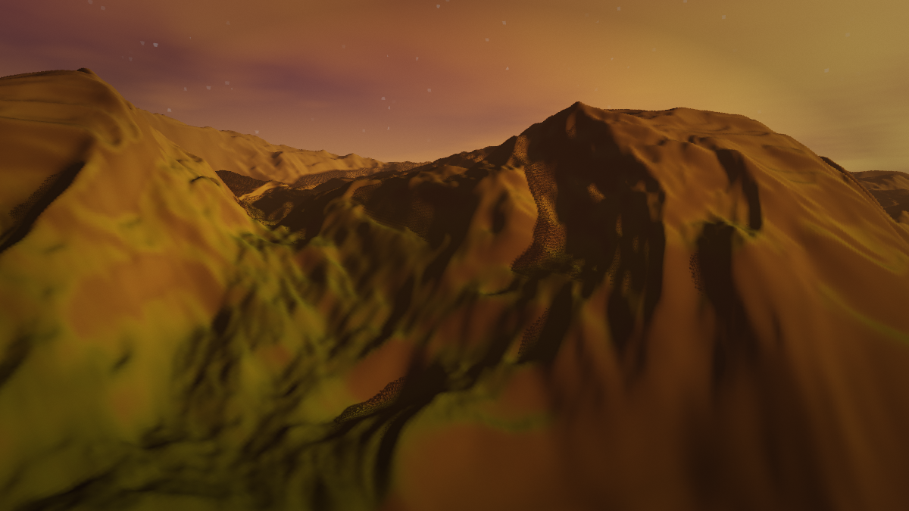
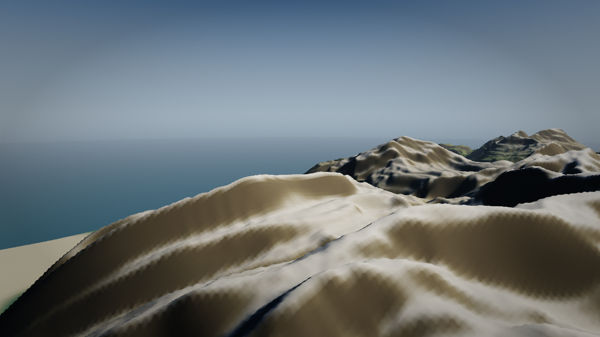
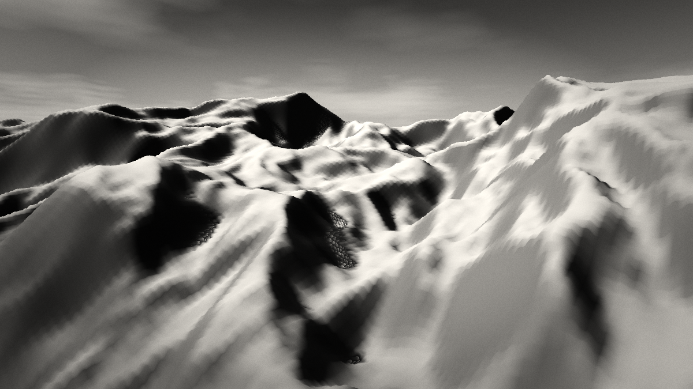

# theme1

Procedural 3D environment generation and CPU image rendering, in TypeScript.

Give it a seed and a theme, and it produces a landscape image: heightfield
terrain, a resolved water surface, a volumetric cloud layer, atmosphere, and
either a photoreal or monochrome grade. No GPU, no headless browser, no
runtime dependencies.

```bash
bun install
bun run render -- --seed 3 --theme dusk --out renders/dusk.png
```



*Theme `dusk`, seed 3. Nothing here was modelled or painted: the terrain, the
water, the clouds and the light all come out of a theme file and a number.*

<table>
<tr>
<td></td>
<td></td>
</tr>
<tr>
<td align="center"><code>alpine</code>, seed 3</td>
<td align="center"><code>monochrome</code>, seed 3</td>
</tr>
</table>


---

## The one rule

**Generation and rendering are separate.**

A `World` is pure data describing a place. A renderer is one of several ways to
look at it. Nothing in `src/world` imports anything from `src/render`, and the
test suite asserts the two renderers agree on where the ground is.

```
Theme  ──▶  WorldGenerator  ──▶  World (data)
                                    │
                    ┌───────────────┴───────────────┐
                    ▼                               ▼
           CPU ray marcher                   three.js viewer
           (renderToPng)                     (public/index.html)
                    │                               │
                    ▼                               ▼
                 PNG image                    interactive scene
```

The three.js viewer exists to keep this honest. If the world model were secretly
shaped around ray marching, a completely different renderer could not read it.

## Determinism

The same seed and theme always produce the same world and the same image, byte
for byte. This is a tested property, not a hope:

```bash
bun test          # includes: serial and worker output are identical
```

How it is achieved:

- `Math.random()` is never called. Every random stream comes from
  `streamSeed(seed, name)`, a 32-bit hash of the parent seed and a stream name.
- Each subsystem takes its own named stream, so adding a generator cannot shift
  the numbers any other generator sees.
- Shading never depends on iteration order or on a shared mutable scratch buffer
  across tiles. Dither is hashed from the pixel index.
- The render divides into horizontal tiles that write only their own rows, so the
  worker pool produces the same bytes as a single thread. There is a test for
  exactly this.
- Animation is driven by an explicit `time` parameter, never by a clock.

## Install

Requires [Bun](https://bun.sh) (the worker pool and the test runner are Bun
flavoured). `three` is a dev dependency used only by the browser viewer.

```bash
bun install
```

## Command line

```bash
bun run render -- [options]              # one image
bun run render -- themes                 # list the presets
bun run render -- validate <name>        # check a theme, print warnings
bun run render -- batch --seeds 1 2 3    # several seeds
bun run bench                            # performance probe
bun run serve                            # the three.js viewer
```

| Option | Meaning |
| --- | --- |
| `--seed <n>` | world seed |
| `--theme <name>` | preset name |
| `--out <path>` | output PNG |
| `--width` / `--height` | image size |
| `--quality` | `preview`, `standard` (default) or `high` |
| `--camera` | `auto`, `aerial`, `vista`, `ground`, `closeup` |
| `--fov <deg>` | override the field of view |
| `--time <s>` | world time, drives waves and cloud drift |
| `--workers <n>` | worker threads; `1` disables the pool |
| `--resolution <n>` | terrain grid cells per side |
| `--set <path=value>` | override any theme field, repeatable |
| `--no-water`, `--no-clouds`, `--no-shadows`, `--no-reflections` | effect switches |
| `--monochrome` | force the monochrome look |
| `--quiet` | print only the output path |

`--set` is the art direction tool. Anything the theme schema accepts can be
overridden from the shell, with values parsed as JSON:

```bash
bun run render -- --theme alpine --set terrain.amplitude=900 \
  --set palette.snowLine=500 --set lighting.sunDirection='{"x":0.5,"y":0.6,"z":-0.6}'
```

## Library

```ts
import { defineTheme, generateWorld, renderToPng, PRESETS } from './src/index.ts'

const theme = defineTheme({ ...PRESETS.dusk, name: 'my-dusk' })
const world = generateWorld({ seed: 7, theme })

console.log(world.terrain.maxHeight, world.water.coverage)

await renderToPng('renders/mine.png', { world, quality: 'high' })
```

Reuse a world across several renders — generation is the expensive part:

```ts
const world = generateWorld({ seed: 7, theme })

for (const camera of ['aerial', 'vista', 'ground'] as const) {
  await renderToPng(`renders/${camera}.png`, { world, camera })
}
```

The interesting lower level pieces are all exported: `traceTerrain`,
`traceShadow`, `skyRadiance`, `marchClouds`, `shadeWater`, `bakeNormals`,
`shadeTerrainCell`, `encodePng`, and the noise, RNG and colour primitives.

## How an image is made

### Generation

```
theme + seed
   │
   ├─ shape noise        low frequency land/ocean mask, and the coastline
   ├─ range mask         decides where mountains are allowed to be tall
   ├─ domain warped fBm  the actual relief, mixed with ridged noise
   ├─ thermal erosion    anything steeper than the talus angle slides downhill
   ├─ water level        resolved from the height histogram, so "35% water"
   │                     really is 35% water whatever the terrain did
   ├─ derived fields     slope, moisture, temperature
   └─ baked appearance   albedo and roughness, as sRGB bytes
   │
   ▼
World: heights, normals, albedo, roughness, water, light
```

The output is a set of typed arrays. Rendering then only ever does array
lookups, never re-evaluates noise, which is what makes a no-GPU renderer
viable.

Two details that mattered more than expected:

- **Normals are baked, not differenced.** Finite differences from a bilinear
  heightfield are piecewise constant per cell, so every cell edge shows as a
  facet. A baked normal map, interpolated across the cell, shades smoothly.
- **The material masks need smooth inputs.** A per cell slope threshold paints
  single cell rock patches across the whole world, and normalized fractal noise
  clusters so tightly around its midpoint that every mask built on it collapses
  into thin contour-following stripes. The slope field is blurred before it
  drives anything, and the moisture field is expanded around its midpoint.

The treeline matters more than it looks. Slope alone cannot place rock, because
in steep country the median slope is above any sensible threshold, so a
slope-only mask covers the entire world grey. `palette.treeLine` is what
produces the banding a real range has: forest, alpine turf, bare rock, snow.


### Rendering

Per pixel: build a ray, find the terrain, then water, then sky, composite the
cloud volume in front of whatever was found, and apply aerial perspective.

- **Terrain intersection** is a distance-proportional step capped at half the
  vertical gap to the surface. Because the ray direction is normalized the gap
  shrinks by at most the step, so the cap can never step through the surface:
  no holes in ridgelines, and far more ground covered per step. A crossing is
  then bisected to land cleanly.
- **Shadows** normalize the penumbra by `t · sunY` rather than by distance
  alone. Over flat ground the clearance *is* proportional to distance, so a
  plain `clearance / distance` ratio reports a level plain as heavily shadowed.
- **Water** is a plane at the resolved level. Fresnel-weighted, with a reflected
  ray, a refracted ray, Beer-Lambert extinction through the column, a sun glint
  that roughens with distance, and foam in the shallows.
- **Clouds** are a slab marched front to back with a Henyey-Greenstein phase and
  a short march towards the sun at every occupied sample. Samples with no
  density skip both the erosion octaves and the light march.
- **Everything ends in one tone map** (ACES by default), then the grade:
  saturation, vignette, deterministic grain, and the monochrome path.

## Performance

Measured with `bun run bench` on an M-series Mac, 6 workers, the `alpine`
theme at a 1536² heightfield:

| | rays | generate | render |
| --- | --- | --- | --- |
| 480×270 preview | 0.1M | 3.7 s | 0.7 s |
| 1280×720 standard | 3.7M | 3.7 s | 4.7 s |
| 1920×1080 standard | 8.3M | 3.7 s | 10.7 s |
| 1920×1080 high | 18.7M | 3.7 s | 34.0 s |

Two things to take from this:

- **Generation is the fixed cost and it does not scale with image size.**
  Reuse the world across renders: loop over cameras, not over worlds.
- **The volumetric cloud pass is the single most expensive stage**; disabling
  it cuts roughly a third off render time.

Worker scaling is sublinear — 6 threads give about 2.5× the throughput of one,
which is what you would expect on a machine whose cores are partly
hyperthreads. Tiles are independent, so the result is identical either way.

## Themes

A theme is configuration, not code. No generator or renderer branches on a
theme *name*; a new look means new data.

```ts
export const archipelago: ThemeDraft = {
  name: 'archipelago',
  terrain: {
    worldSize: 3000,
    amplitude: 300,
    ridgedMix: 0.38,
    seaThreshold: -0.12,   // coastline sits lower: more ocean
    waterFraction: 0.62,
  },
  water: { shallowColor: '#5fd6c8', turbidity: 0.022 },
  lighting: { sunDirection: { x: -0.6, y: 0.5, z: -0.62 } },
}
```

`defineTheme` merges a draft over the defaults at every depth, normalizes the
sun direction, validates the result, and fills in any step budget you left
unset. A budget you *did* set is never overwritten by the quality profile — use
`withQuality(theme, 'high')` when you explicitly want a profile applied.

Presets: `alpine`, `desert`, `archipelago`, `monochrome`, `dusk`.

## The three.js viewer

```bash
bun run viewer:build
bun run serve          # http://localhost:5173
```

A second renderer over the same world data: baked vertex colours, baked
normals, a water plane at the resolved level, a shader cloud layer, and a sky
dome that mirrors the CPU sky's gradient. Drag to orbit, wheel to zoom, `WASD`
to pan, `R` for the next seed. Query parameters: `?seed=42&theme=dusk&animate=1`.

The world-to-geometry mapping lives in `src/render/three/terrainMesh.ts` with no
three.js dependency at all, so it is tested in plain bun against the same
sampling functions the CPU renderer uses.

## Layout

```
src/
  core/          math, seeded RNG, Perlin noise, colour and tone mapping
  theme/         the theme schema, defaults, validation, presets
  world/         the generators; produces a World and knows nothing about pixels
    terrain/     heightfield, erosion, normals, albedo bake, sampling
    water/       water level resolution
  render/
    common/      camera, framebuffer, tone map and grade, camera composition
    cpu/         the ray marcher, split by concern
    png/         a dependency-free PNG encoder
    three/       the browser viewer
  cli/           render, batch, themes, validate, bench, serve
  index.ts       the public API
scripts/
  cameras.ts     camera scorer diagnostic
  tune.sh        small preview render with theme overrides
test/            151 tests
```

## Tests

```bash
bun test
bun run typecheck
```

The suite covers the RNG's determinism and avalanche properties, noise ranges
and reproducibility, theme merging and validation, terrain validity (no NaN,
unit normals, in-bounds sampling at the tile boundary), the PNG encoder round
trip including a decode of its own output, the render invariants (serial equals
parallel, time is a parameter, disabling effects still renders), and agreement
between the two renderers.

Several of the tests exist because they caught something. The in-bounds one
guards a real out-of-bounds read: a bilinear tap at the corner cell asks for
the cell's `+1` neighbour, JavaScript returns `undefined` one past the end of a
typed array, and the result is a silent NaN at the tile border rather than a
crash.

## The camera

There is no hand-placed viewpoint, so one is composed from the terrain: a ring
of candidate positions around the tallest peak, each with a view direction, is
scored on how much relief it sees, whether the foreground blocks the sightline,
how much of the frame is water, how far off the view axis the sun sits, and
where the horizon lands.

Two things about it are worth knowing before changing it:

- A candidate is an eye position plus an azimuth and a **depression angle**,
  not an eye and a look-at point. Composition is mostly about where the horizon
  sits, and with a look-at point the depression is an accident of where the
  target happens to be.
- Every score term is a **mean** over the sample count. Mixing a term that
  sums to fifty with terms that max out at two makes the weights meaningless,
  and the big term silently wins every comparison.

`bun run scripts/cameras.ts <theme> <seed>` prints the candidate table with
every score component, which is the only sane way to debug framing. Pass an
explicit `camera` to `renderImage` when you want a specific frame.

## Known limitations

- The world is a single square tile. Rays leaving it read as open sea, and an
  edge falloff tapers the land into the sea at the border, but there is no
  neighbouring tile to continue into.
- Erosion is thermal only. No hydraulic erosion, no sediment transport.
- No vegetation, trees or rocks yet. The palette and descriptor fields
  (moisture, temperature, slope) are already computed and baked, so scatter
  placement has what it needs.
- The three.js viewer is verified by build and by unit tests over its
  world-to-geometry mapping, but has not been run in a browser in this
  environment.
- Camera composition is deterministic but not art directed. It reliably
  produces a landscape; it will not reliably produce the landscape you had in
  mind.
- There is no temporal accumulation, so there is no progressive refinement:
  a higher `--quality` costs proportionally more rather than converging over
  time.

